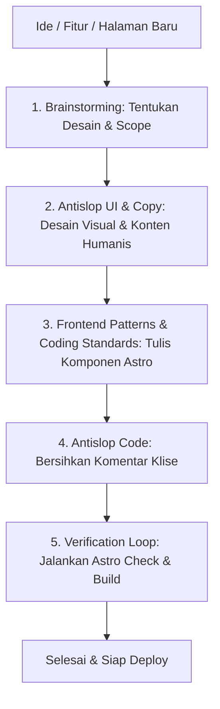

# Panduan Penggunaan Skills (Everything Claude Code & Antigravity Ecosystem)

Dokumen ini berisi panduan praktis, katalog lengkap, dan contoh prompt untuk memanfaatkan seluruh **Skills** yang terpasang di environment Antigravity Anda (`~/.gemini/config/skills/`), termasuk integrasinya dengan proyek **Portfolio** ini.

---

## 1. Bagaimana Cara Kerja Skills di Antigravity?

Antigravity menggunakan pendekatan **Progressive Disclosure**:
1. **Otomatis (Context-Aware):** Antigravity membaca ringkasan deskripsi semua skill. Jika tugas Anda menyentuh area tertentu (misal: UI, bugfix, testing), skill relevan otomatis dipicu.
2. **Eksplisit (Direct Mention):** Anda dapat menyebutkan nama skill langsung di dalam prompt untuk memaksa Antigravity mengikuti alur kerja dan checklist formal dari skill tersebut.

---

## 2. Katalog Skills & Contoh Penggunaannya

### A. Core Development & Quality Gate (Everything Claude Code)

#### 1. `tdd-workflow` (Test-Driven Development)
* **Kapan Digunakan:** Membuat fitur baru, kalkulasi logika bisnis, atau bugfix dengan siklus *Red-Green-Refactor* dan target coverage 80%+.
* **Contoh Prompt:**
  > *"Gunakan skill `tdd-workflow` untuk membuat fungsi kalkulasi filter project ini (tulis test gagal terlebih dahulu)."*

#### 2. `coding-standards` (Standar Kualitas & Kebersihan Kode)
* **Kapan Digunakan:** Menjaga kode tetap bersih, mematuhi prinsip KISS (*Keep It Simple*), DRY, modular, dan standar TypeScript modern tanpa over-engineering.
* **Contoh Prompt:**
  > *"Refactor helper utility ini agar mematuhi aturan `coding-standards`."*

#### 3. `frontend-patterns` (Pola Frontend & Komponen Modern)
* **Kapan Digunakan:** Mendesain komponen UI Astro/React, manajemen state, komposisi komponen, dan optimasi performa render.
* **Contoh Prompt:**
  > *"Buat komponen ProjectCard dengan pola komposisi sesuai `frontend-patterns`."*

#### 4. `backend-patterns` (Arsitektur & Pola Backend)
* **Kapan Digunakan:** Mendesain API endpoint, Repository Pattern, error handling terpusat, dan integrasi database (jika menambah API route/serverless).
* **Contoh Prompt:**
  > *"Rancang API endpoint untuk form kontak menggunakan standar `backend-patterns`."*

#### 5. `security-review` (Audit Keamanan)
* **Kapan Digunakan:** Penanganan form input kontak, sanitasi data, header keamanan, mitigasi XSS/CSRF, atau pengelolaan secret/environment variable.
* **Contoh Prompt:**
  > *"Lakukan `security-review` terhadap form kontak dan endpoint pengiriman pesan ini."*

#### 6. `verification-loop` (Quality Gate & Pengecekan Akhir)
* **Kapan Digunakan:** Sebelum commit atau menyelesaikan tugas besar. Menjalankan linting, typecheck, build, dan test untuk memastikan zero-regression.
* **Contoh Prompt:**
  > *"Fitur sudah selesai. Jalankan `verification-loop` untuk memverifikasi build dan typecheck."*

#### 7. `eval-harness` (Eval-Driven Development)
* **Kapan Digunakan:** Untuk tugas kompleks/krusial. Menetapkan kriteria evaluasi (Capability Evals dan Regression Evals) sebelum implementasi kode.
* **Contoh Prompt:**
  > *"Gunakan `eval-harness` untuk mendefinisikan kriteria sukses dan batasan regresi sebelum kita merefaktor sistem navigasi."*

#### 8. `strategic-compact` (Manajemen Token & Konteks)
* **Kapan Digunakan:** Pada percakapan panjang agar konteks token tetap efisien. Memberi tahu momen paling tepat untuk menjalankan `/compact`.
* **Contoh Prompt:**
  > *"Gunakan panduan `strategic-compact` untuk mengevaluasi apakah sekarang saat yang tepat untuk merapikan konteks percakapan."*

#### 9. `continuous-learning` (Ekstraksi Pola Baru)
* **Kapan Digunakan:** Mengubah solusi perbaikan berulang atau preferensi khusus menjadi skill permanen baru.
* **Contoh Prompt:**
  > *"Simpan pola penataan styling Astro yang baru saja kita sepakati menggunakan alur `continuous-learning`."*

---

### B. Craftsmanship & Anti-Slop (Sangat Penting untuk Portfolio)

Portfolio personal membutuhkan sentuhan estetika tinggi dan tidak boleh terlihat seperti template generik buatan AI. Gunakan suite **anti-slop**:

| Skill | Fokus Utama | Kapan Digunakan |
|---|---|---|
| `antislop-ui` | Desain UI, hierarki visual, kontras, micro-interaction, tipografi | Saat mendesain layout, hero section, card, button, dan tema |
| `antislop-copywriting` | Tone of voice manusiawi, natural, tanpa jargon klise AI | Saat menulis bio, deskripsi proyek, tagline, atau CV |
| `antislop-layoutmobile` | Desain responsif phone/tablet/desktop, tap target, no overflow | Memastikan portfolio tampil sempurna di layar mobile |
| `antislop-code` | Kebersihan kode tanpa komentar AI klise (*no obvious comments*) | Membersihkan komentar kode yang tidak perlu sebelum commit |

* **Contoh Prompt:**
  > *"Tulis ulang bagian About Me dengan `antislop-copywriting` agar terdengar percaya diri, natural, dan bebas dari kata-kata klise AI."*  
  > *"Review styling section hero ini menggunakan `antislop-ui` untuk memastikan hierarki visual dan spacing-nya kokoh."*

---

### C. Alur Rekayasa (Superpowers)

| Skill | Fungsi |
|---|---|
| `brainstorming` | Eksplorasi ide dan klarifikasi kebutuhan sebelum menulis kode/rencana |
| `writing-plans` | Menyusun implementasi bertahap (*step-by-step*) dengan checklist jelas |
| `systematic-debugging` | Investigasi akar masalah secara sistematis saat ada bug atau build error |

---

## 3. Klarifikasi Prioritas & Skill yang Mirip

Jika ada beberapa skill dengan fungsi berdekatan, gunakan panduan prioritas berikut:

1. **Testing:**
   - Gunakan `tdd-workflow` jika ingin fokus pada target cakupan test kuantitatif (80%+ coverage, unit & E2E).
   - Gunakan `test-driven-development` saat mengikuti alur ketat Superpowers (Red -> Green -> Refactor).
2. **Verifikasi Akhir:**
   - Gunakan `verification-loop` untuk menjalankan script automated checks (`npm run build`, `npm run check`, linter).
   - Gunakan `verification-before-completion` sebagai prinsip guardrail: *tidak boleh mengklaim selesai sebelum melihat bukti log bahwa verifikasi lolos*.

---

## 4. Rekomendasi Alur Kerja Proyek Portofolio

### Praktik Terbaik di Proyek Ini:
1. **Untuk Halaman / Komponen Baru:**
   > *"Saya ingin membuat section Testimoni / Pengalaman Kerja. Gunakan `antislop-ui` dan `frontend-patterns` untuk merancang komponen Astro yang clean dan responsif."*
2. **Untuk Penulisan Konten Portofolio:**
   > *"Bantu saya menulis studi kasus proyek X untuk portofolio ini menggunakan `antislop-copywriting`."*
3. **Sebelum Git Commit:**
   > *"Jalankan `verification-loop` untuk memastikan tidak ada error TypeScript dan `astro build` sukses 100%."*
